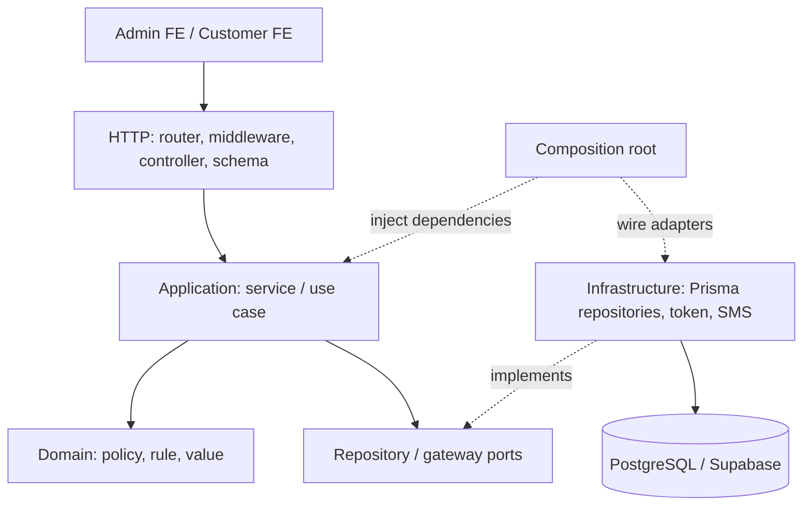

# Backend Architecture — Modular Monolith and N-Layer Design

Status: proposed on 23 November 2026. This is shared backend context; read the [scope and foundational decisions](README.md) first.

## 1. What monolith means here

One backend codebase, one build/deployment unit, one Express API at `/api/v1`, and one shared PostgreSQL database. Modules communicate through in-process functions with explicit interfaces. Module boundaries organize code and team responsibilities; they do not create eight separate HTTP applications.

A monolith should not become one global `services/` directory containing every business operation. With eight modules and 90 planned APIs, organize **by business capability first, then by layer**. This follows the general guidance on [component boundaries](https://github.com/goldbergyoni/nodebestpractices/blob/master/sections/projectstructre/breakintcomponents.md); the examples below are specific to MilktyWay.

Reasons for this choice:

- The team can run, debug, and deploy one application.
- Users, assignments, sessions, and audit records can be updated in one transaction.
- Explicit boundaries discourage arbitrary database access across modules.
- Service discovery, network retries, and distributed transactions are unnecessary at this stage.

Trade-off: modules deploy together, so import boundaries must contain the impact of changes. A shared database permits joins but does not grant modules unrestricted write access to one another's tables.

## 2. Layers: four responsibilities, not four servers



The usual execution path is `router → middleware → controller → service → repository → Prisma → PostgreSQL`. Domain code contains rules called by services; requests do not need to pass through empty entity classes merely to satisfy a diagram.

### 2.1. HTTP / Presentation

Includes `*.routes.ts`, `*.controller.ts`, `*.schema.ts`, `*.presenter.ts`, and HTTP middleware.

- Routers declare endpoints and their middleware.
- Schemas validate params, query strings, and bodies, producing validated DTOs.
- Authentication middleware builds `AuthContext`; authorization middleware performs preliminary action checks.
- Controllers read validated input, call a service, and select the HTTP status and presenter.
- Presenters expose only fields permitted by the contract; they do not serialize complete `User` records.

Controllers do not hash passwords, open transactions, query Prisma, or implement branch-management rules. Do not pass the entire `req`, `res`, cookies, or headers into a service.

### 2.2. Application

Services/use cases coordinate business actions such as `loginStaff`, `refreshSession`, `updateUserAccess`, and `assignStaffToBranch`.

- Accept typed input and the acting principal's context.
- Load required data through repositories and apply domain policies.
- Define transaction boundaries.
- Call token, password, and OTP gateways through injected dependencies.
- Return application DTOs without choosing HTTP status codes.

A small service can contain several related functions in one file. Introduce a `use-cases/` directory when flows become independent; a separate class for every CRUD operation is not required.

### 2.3. Domain

Contains business rules and types independent of Express, Prisma, Supabase, and HTTP:

- `StaffRole`, `AccessScope`, and `AuthenticatedPrincipal`.
- `canManageStaffAccess(actor, target, change)`.
- `canAssignStaff(actor, target, destination)`.
- Invariants: managers cannot grant ADMIN, elevate themselves, or modify staff outside their scope.

Prefer pure functions and plain objects. Add entities or value objects with behavior when they protect an actual invariant; do not duplicate every Prisma table as a class just to fill a layer.

### 2.4. Infrastructure / Persistence

- Repositories implement Prisma queries, including projections, filters, pagination, and conditional writes.
- Adapters implement password hashing, token signing/verification, SMS delivery, and challenge storage.
- Map recognized ORM errors to application errors; let the error handler deal with unexpected failures.
- Create one Prisma client at the composition root per process and reuse it through dependency injection.

Prisma models represent persistence. Public response DTOs and domain models are not automatically identical to Prisma models.

## 3. Proposed directory structure

This is the proposed structure **inside `MilktyWay-BE`**. It has not been scaffolded as part of this documentation change.

```text
MilktyWay-BE/
  prisma/
    schema.prisma
    migrations/
    seed.ts
  src/
    app.ts
    server.ts
    bootstrap/
      container.ts
      routes.ts
    config/
      env.ts
    shared/
      application/
        errors.ts
        auth-context.ts
      http/
        error-handler.ts
        request-id.ts
      infrastructure/
        database/prisma-client.ts
        logging/logger.ts
    modules/
      auth-users/
        index.ts
        http/
          auth.routes.ts
          auth.controller.ts
          auth.schema.ts
          auth.presenter.ts
          users.routes.ts
        application/
          auth.service.ts
          users.service.ts
          ports/
            user.repository.ts
            session.repository.ts
            auth-unit-of-work.ts
            token.gateway.ts
            password-hasher.ts
            otp.gateway.ts
        domain/
          staff-role.ts
          access-scope.ts
          user-access.policy.ts
        infrastructure/
          prisma-user.repository.ts
          prisma-session.repository.ts
          prisma-auth-unit-of-work.ts
          jwt-token.gateway.ts
          argon-password-hasher.ts
        tests/
          user-access.policy.test.ts
          auth.integration.test.ts
      branch/
      catalog/
      inventory/
      order/
      payment/
      promotion/
      reporting/
  tests/
    e2e/
    helpers/
  prisma.config.ts
  package.json
```

Non-AU modules are planned locations, not a reason to create empty directories. A small module may keep presentation mapping in its controller, provided the response allowlist remains explicit.

`app.ts` creates the Express app and accepts dependencies; it does not call `listen`. `server.ts` loads configuration, wires adapters, starts listening, and handles shutdown. Tests can import the app without automatically starting a real server.

## 4. Dependency rules

- HTTP may import application contracts and public types, but not Prisma repository implementations.
- Application may import domain code and application-owned ports, but not Express or Prisma runtime APIs/types.
- Domain must not import application, HTTP, or infrastructure code.
- Infrastructure may import domain types and application ports to implement them.
- `bootstrap/container.ts` may know both services and implementations so it can wire them together.
- Module A consumes Module B through exports from `modules/B/index.ts` or an injected port. It must not deep-import B's repositories.
- Avoid exporting every implementation through barrel files. Public entry points expose only the required contracts and types.
- Do not import business modules into `shared/`. Share code only when it has the same meaning across modules, not merely a similar name.

This is dependency inversion: a service calls a repository at runtime, but its source depends on an **interface**, not the Prisma adapter.

Simplified wiring example, not independently executable source:

```ts
// bootstrap/container.ts
const userRepository = createPrismaUserRepository(prisma);
const authUnitOfWork = createPrismaAuthUnitOfWork(prisma);
const authService = createAuthService({
  userRepository,
  authUnitOfWork,
  passwordHasher,
  tokenGateway,
  clock,
});
```

Prefer factories with dependency objects. A DI framework, global service locator, generic `BaseService`, or generic `BaseRepository` is not needed initially.

## 5. Boundaries of the eight modules

- **AU / `auth-users`:** staff/customer identities, credentials, sessions, OTP, membership profiles, assignments, and identity policies. `/customers/*` paths do not introduce a ninth Customer module.
- **BR / `branch`:** branches, delivery zones, POS terminals, and cash shifts. AU may check branch/terminal validity through a public BR port.
- **CA / `catalog`:** products, sizes, options, prices, recipes, drafts, and branch-specific availability.
- **IN / `inventory`:** ingredients, lots, stock, purchasing/receipts, preparation batches, central-to-branch supplies, and stock counts.
- **OR / `order`:** orders, items, queues, complaints, and change/cancellation requests. Detailed state-machine decisions are deferred.
- **PA / `payment`:** transactions, verification, refunds, and payment reconciliation.
- **PM / `promotion`:** promotions, loyalty policies, point ledgers, and tiers. AU owns membership profiles; PM owns points, tiers, and offers.
- **RP / `reporting`:** read models, report queries, and period costs defined by the contract. It must not rewrite source transactions to change report results.

An OR use case that needs CA/PM information calls the appropriate read port. Order code must not directly modify price tables, promotion budgets, or point ledgers. Cross-module atomic work uses a shared unit of work composed from module-owned repositories; modules do not call HTTP endpoints on their own backend.

Reporting may use dedicated read-only queries that join multiple modules' tables. This is a deliberate read-side exception, not a route for cross-module writes.

## 6. Transactions, concurrency, and side effects

Services define **what must be atomic**; infrastructure implements the transaction. For example, a staff-access update must accompany session revocation and an audit record. Repository A must not commit its part before repository B attempts the remaining work.

A unit-of-work port can accept a callback exposing repositories bound to **the same transaction client**:

```ts
// Application pseudocode: Prisma.TransactionClient does not appear here.
await authUnitOfWork.run(async ({ users, sessions, audit }) => {
  const target = await users.findForAccessChange(input.userId);
  assertCanManageUserAccess(actor, target, input);
  await users.updateAccess(input);
  await sessions.revokeAllForUser(input.userId);
  await audit.recordAccessChange(actor, target, input.reason);
});
```

Infrastructure opens the Prisma transaction and binds all repositories to `tx`; it must not mix in the global client inside the callback. This is the proposed application pattern. [Prisma transactions](https://www.prisma.io/docs/orm/v7/prisma-client/queries/transactions) provide commit/rollback mechanisms, not the application's business invariants.

- Recheck scope and state within the transaction or use conditional writes when concurrent changes are possible.
- Use compare-and-swap/conditional updates for refresh-token rotation so only one request consumes the old token.
- Enforce duplicate-prevention invariants with unique constraints and handle conflicts explicitly.
- Select isolation/locking based on the invariant; retry conflicts/deadlocks with a bounded policy only when safe.
- Do not call SMS, email, or external APIs inside a long-running database transaction.
- Write audit records in the business transaction when their existence must be atomic. SMS delivery is a gateway side effect. Add an outbox when reliable delivery is required; in-memory events are not durable.

## 7. Operational baseline

- Validate configuration once at startup and fail clearly when required settings are missing.
- Include request IDs in logs and errors. Emit structured JSON logs to stdout; never log tokens, passwords, or OTPs.
- Liveness checks the process. Readiness checks essential dependencies with short timeouts. Neither exposes connection strings.
- Graceful shutdown stops accepting new requests, waits for in-flight work within a timeout, and closes database pools using the selected adapter's API. Do not create clients per request.
- Authentication rate limits need shared storage when multiple replicas run. Sessions and challenges must not exist only in process memory.
- Run migrations as one deployment job before rollout, not independently on every replica at startup.

## 8. A practical implementation sequence

1. Bootstrap app/configuration/error handling/logging/Prisma and verification tools.
2. Complete one AU vertical slice: login route → schema → service → repository → database → response DTO.
3. Add refresh/logout/me and HTTP integration tests against a separate PostgreSQL test database.
4. Add role/branch policies, access management, and staff assignments, then integrate the Admin FE.
5. Implement customer OTP and profiles. Keep detailed OR/PA state-machine work deferred.

The architecture is demonstrated by a working vertical slice that respects boundaries, not by the number of interfaces or directories.
